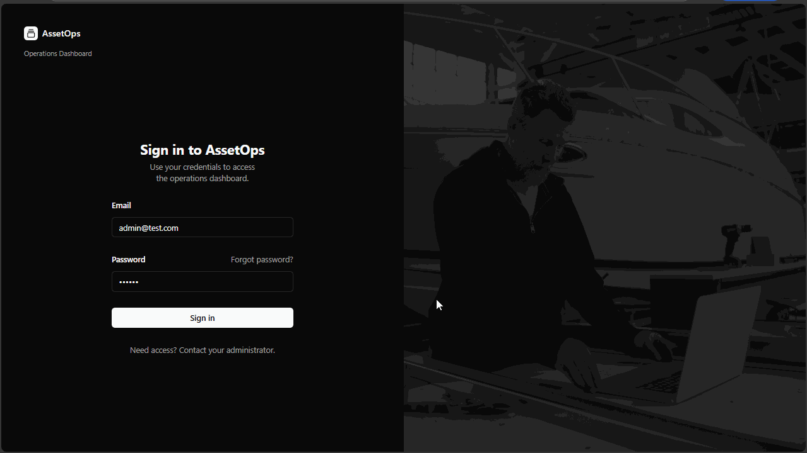
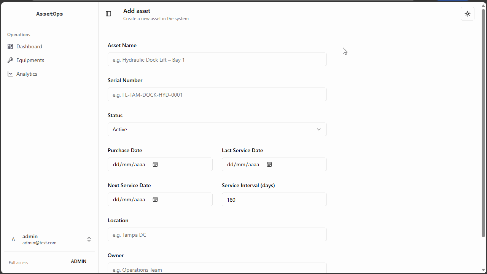
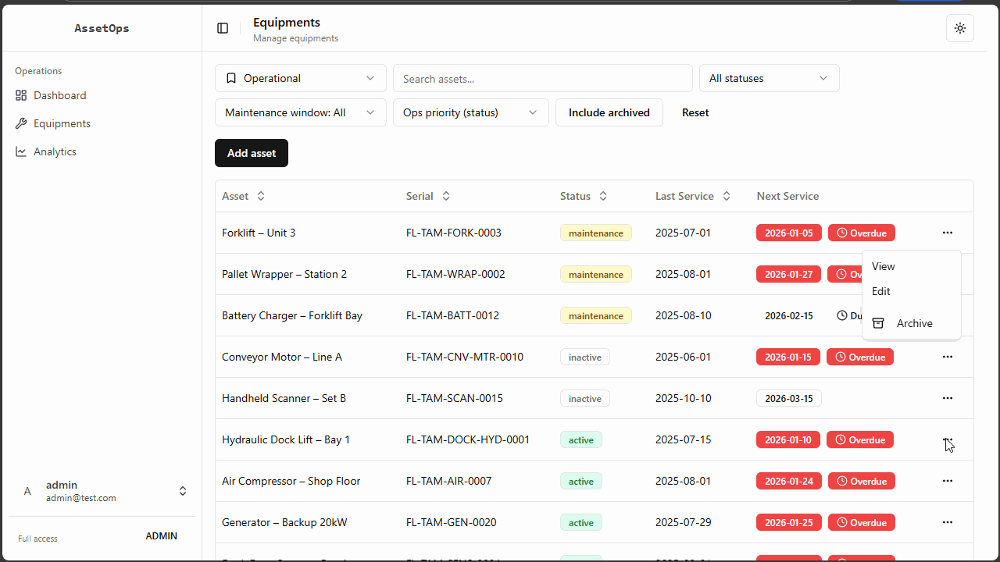
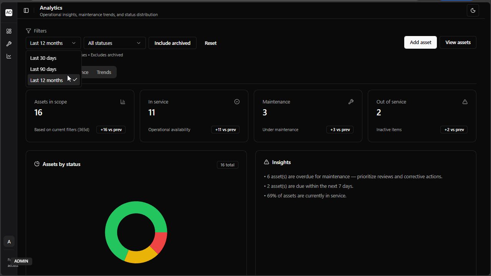

# 🏭 AssetOps: Equipment Management System

> An asset tracking platform with maintenance scheduling, role-based access control, and an append-only audit log.

**🔗 Live Demo:** [asset-ops.vercel.app](https://asset-ops.vercel.app/login)
**📧 Demo Login:** `client@test.com` / `123456`

---

## 📸 Screenshots

**Dashboard Overview**


**Equipment Management**


**Maintenance Tracking**


**Analytics Page**


---

## 🎯 The Problem

Companies managing physical assets (machinery, tools, equipment) need to:

- Track equipment status and location
- Schedule and log maintenance activities
- Prevent equipment downtime through proactive maintenance
- Control access based on user roles

AssetOps solves these challenges with a scalable, secure solution.

---

## ✨ Key Features

### 📊 Asset Management

- Complete equipment lifecycle tracking
- Status monitoring (Active, Inactive, Under Maintenance)
- Automatic maintenance scheduling based on service intervals
- Equipment availability tracking

### 🔧 Maintenance System

- Scheduled maintenance tracking
- Service history with detailed logs
- Overdue maintenance alerts
- Automatic next service date calculation

### 🔐 Security & Permissions

- Role-based access control (Admin/Viewer)
- Firestore security rules enforcement
- Protected routes and actions
- Secure authentication flow

### 📈 Analytics & Reporting

- Equipment status dashboard
- Maintenance trends visualization
- Data quality metrics
- Overdue equipment tracking

### 🗂️ Audit Trail

- Append-only audit log
- Immutable historical records

---

## 🛠️ Tech Stack

### Frontend

- **Next.js 14** (App Router) and **React 18**: UI framework
- **TypeScript**: Type safety
- **Tailwind CSS**: Styling
- **shadcn/ui**: Component library
- **React Hook Form**: Form management
- **Zod**: Schema validation
- **React Query**: Server state management
- **Recharts**: Data visualization

### Backend & Database

- **Firebase Authentication**: User management
- **Firestore**: NoSQL database
- **Firestore Security Rules**: Backend authorization

### DevOps

- **Vercel**: Deployment & hosting
- **Git/GitHub**: Version control
- **ESLint**: Code quality

---

## 🏗️ Architecture Highlights

### Data Model Design

```
Equipment (Current State)
├── Basic Info (name, type, status)
├── Maintenance Dates (last, next)
└── Subcollections
    ├── Maintenance Records (historical, immutable)
    └── Events (audit trail, immutable)
```

**Key Concept:** Separation of current state vs. historical data

- Equipment collection: mutable current state
- Subcollections: immutable historical records

### Smart Date Calculation

```typescript
nextServiceDate = lastServiceDate + serviceIntervalDays;
```

- No manual input required
- Automatic overdue detection
- Prevents human error

### Security Architecture

- **Frontend:** UI-level role checks
- **Backend:** role checks enforced in Firestore rules
- Even if frontend is bypassed, rules block unauthorized actions

---

## 📦 Installation & Setup

```bash
# Clone repository
git clone https://github.com/EduardoVisconti/AssetOps.git
cd AssetOps

# Install dependencies
npm install

# Set up environment variables
# Create .env.local with:
NEXT_PUBLIC_FIREBASE_API_KEY=your_key
NEXT_PUBLIC_FIREBASE_AUTH_DOMAIN=your_domain
NEXT_PUBLIC_FIREBASE_PROJECT_ID=your_project_id
NEXT_PUBLIC_FIREBASE_STORAGE_BUCKET=your_bucket
NEXT_PUBLIC_FIREBASE_MESSAGING_SENDER_ID=your_sender_id
NEXT_PUBLIC_FIREBASE_APP_ID=your_app_id

# Run development server
npm run dev
```

---

## 🎮 Usage

### Demo Accounts

- **Admin:** `admin@test.com` / `123456`
- **Viewer:** `client@test.com` / `123456`

### Key Workflows

**1. Create Equipment**

- Navigate to Equipment page
- Click "New Equipment"
- Fill required fields (name, type, service interval)
- System automatically calculates first service date

**2. Log Maintenance**

- Select equipment
- Click "Add Maintenance"
- Enter service details
- System updates next service date automatically

**3. Monitor Dashboard**

- View equipment status
- Track overdue maintenance
- Analyze maintenance trends

---

## 🧪 Code Quality

- **Type Safety:** Full TypeScript coverage
- **Validation:** Zod schemas for all forms
- **Code Organization:** Feature-based structure
- **Security:** Backend-enforced authorization

---

## 🚀 Deployment

Deployed on Vercel with automatic deployments from the `master` branch.

**Production URL:** https://asset-ops.vercel.app

---

## 📚 What I Learned

This project challenged me to:

- Design scalable database architecture for long-term data
- Implement proper separation between mutable state and immutable history
- Build role-based access control with both frontend and backend enforcement
- Handle complex date calculations for automated scheduling
- Structure React applications for maintainability
- Implement comprehensive form validation with type safety

---

## 🔮 Future Enhancements

- [ ] Export maintenance reports (PDF/Excel)
- [ ] Email notifications for upcoming maintenance
- [ ] Mobile app (React Native)
- [ ] Batch equipment import (CSV)
- [ ] Advanced filtering and search
- [ ] Equipment categories and tags

---

## 👨‍💻 Author

**Eduardo Visconti**

- GitHub: [@EduardoVisconti](https://github.com/EduardoVisconti)
- LinkedIn: [linkedin.com/in/eduardo-visconti](https://linkedin.com/in/eduardo-visconti)
- Email: eduardo.visconti.dev@gmail.com

---

## 📄 License

This project is open source and available under the [MIT License](LICENSE).

---

**Built with ❤️ using React, TypeScript, and Firebase**
